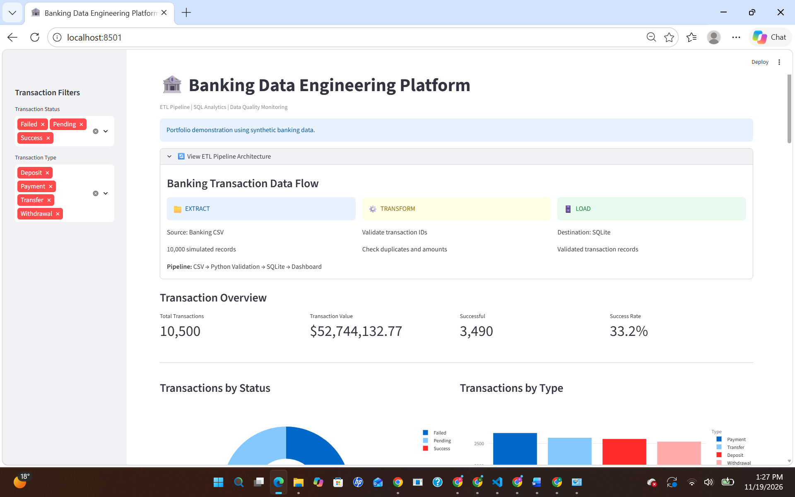
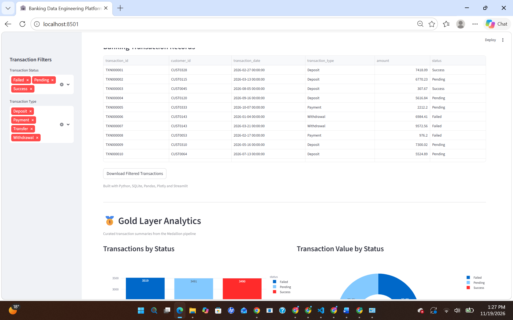
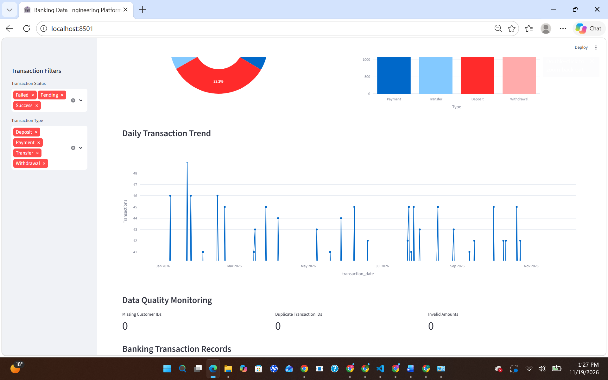
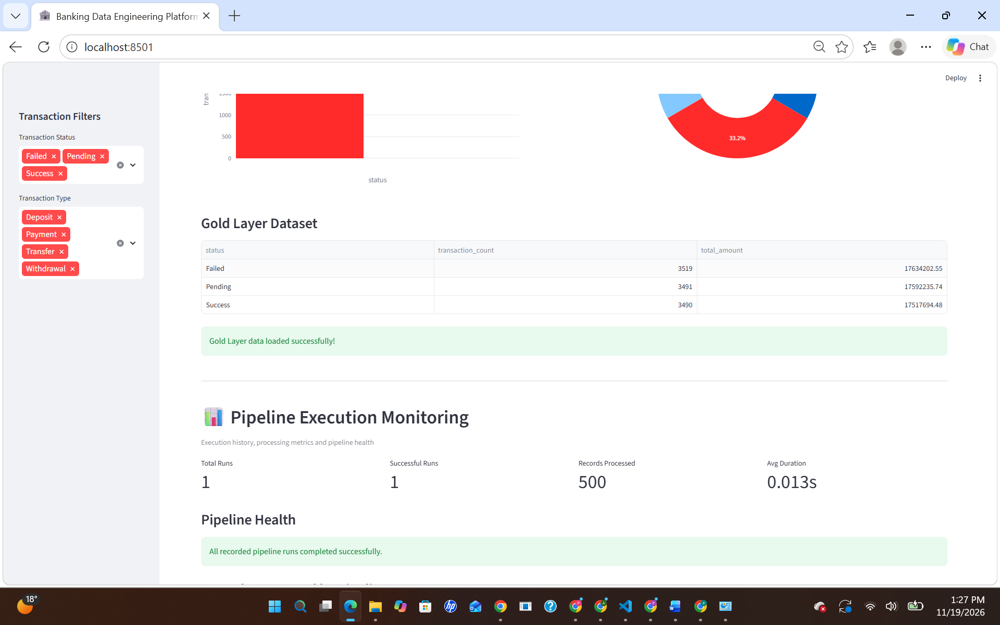

# Banking Data Engineering Platform

An end-to-end banking data engineering portfolio project
built using Python, SQL, SQLite, and Streamlit.

## Project Overview

This platform processes synthetic banking transactions
through an ETL pipeline and a Medallion architecture.

It supports data validation, incremental loading,
duplicate prevention, reconciliation, analytics,
and pipeline execution monitoring.

## Technology Stack

- Python
- SQL and SQLite
- Pandas
- Streamlit
- Plotly
- CSV
- Git and GitHub

## Architecture

Synthetic Banking Data
        |
        v
Bronze Layer (Raw Data)
        |
        v
Silver Layer (Clean Data)
        |
        v
Gold Layer (Aggregated Data)
        |
        v
Streamlit Analytics Dashboard

SQLite stores transaction records for SQL analytics
and incremental loading.

## Key Features

- ETL pipeline development
- Bronze, Silver, and Gold data processing
- Data quality validation
- Incremental data loading
- Duplicate transaction prevention
- Data reconciliation
- SQL-based transaction analytics
- Interactive dashboard
- Pipeline execution monitoring

## Demonstrated Results

- 10,500 synthetic banking transactions processed
- 500 additional transactions loaded incrementally
- Duplicate records skipped on repeated loading
- Bronze, Silver, and SQLite counts reconciled
- 3 Gold-layer transaction status summaries
- Interactive transaction analytics dashboard

## How to Run

Install dependencies:

    python -m pip install pandas streamlit plotly

Generate the initial data:

    python generate_data.py

Run the ETL pipeline:

    python etl_pipeline.py

Create the Medallion layers:

    python bronze_layer.py
    python silver_layer.py
    python gold_layer.py

Launch the dashboard:

    python -m streamlit run dashboard.py

## Data Disclaimer

All banking transactions are synthetically generated.
No real customer or financial information is used.

## Project Purpose

Demonstrate practical data engineering concepts,
including ETL development, data validation,
incremental processing, reconciliation,
SQL analytics, and dashboard visualization.


## Project Screenshots

### 1. Banking Dashboard Overview



### 2. Transaction Analytics



### 3. ETL Architecture



### 4. Pipeline Monitoring




## Complete ETL Pipeline Execution

### 1. Install Dependencies

```bash
python -m pip install -r requirements.txt
```

### 2. Generate Synthetic Banking Data

```bash
python generate_data.py
```

### 3. Load Transactions into SQLite

```bash
python etl_pipeline.py
```

### 4. Build Bronze, Silver, and Gold Layers

```bash
python bronze_layer.py
python silver_layer.py
python gold_layer.py
```

### 5. Initialize Pipeline Monitoring

```bash
python pipeline_monitor.py
```

### 6. Generate and Load Incremental Transactions

```bash
python generate_new_transactions.py
python incremental_load.py
```

### 7. Synchronize and Refresh Data Layers

```bash
python sync_bronze.py
python silver_layer.py
python gold_layer.py
```

### 8. Validate Data Quality and Reconciliation

```bash
python test_data_quality.py
python reconcile_data.py
```

### 9. Launch the Analytics Dashboard

```bash
python -m streamlit run dashboard.py
```

Open http://localhost:8501 in your browser.

## Expected Demonstration Results

After the initial load and incremental update:

- 10,500 synthetic banking transactions
- 500 additional transactions processed
- Bronze, Silver, and SQLite record counts reconciled
- Gold-layer summaries grouped by transaction status
- Interactive analytics and pipeline monitoring dashboard

Results may vary if the synthetic data generation changes.
